# 📊 Roteiro e Apresentação de Slides: Sistema da Central de Relacionamento (CR-NOVACAP)

**Arquivo da Apresentação (PowerPoint):** [`Apresentacao_Sistema_CR_NOVACAP.pptx`](file:///d:/User/Documents/projeto%20novacap/Apresentacao_Sistema_CR_NOVACAP.pptx)  
**Formato:** 16:9 Widescreen | 10 Slides Profissionais (Resumidos como Guia Visual)  
**Identidade Visual:** Azul Marinho NOVACAP (`#0F2C59`), Ciano Esmeralda (`#00A896`), Âmbar (`#F59E0B`) e Cards Clean.  
**Autor / Apresentador:** Anderson de Matos Guimarães | Central de Relacionamento – NOVACAP  

---

## 🎨 Estrutura Geral da Apresentação

```mermaid
flowchart LR
    A[01. Capa Oficial] --> B[02. Contexto & Desafios]
    B --> C[03. Visão Geral da Solução]
    C --> D[04. Módulos do Sistema]
    D --> E[05. Fluxo de Tramitação]
    E --> F[06. Dashboards & Exportação]
    F --> G[07. Segurança & Perfis]
    G --> H[08. Stack Tecnológico]
    H --> I[09. Resultados & Impacto]
    I --> J[10. Síntese & Encerramento]
```

---

## 📑 Detalhamento dos Slides e Roteiro de Fala para o Apresentador

### Slide 1: Capa Oficial (Tema Escuro — Azul Marinho NOVACAP)
- **Título no Slide:** CENTRAL DE RELACIONAMENTO – NOVACAP
- **Subtítulo:** Sistema de Controle de Processos SEI
- **Descrição Visível:** Gestão, Tramitação e Inteligência de Dados para a NOVACAP
- **Rodapé:** Anderson de Matos Guimarães | Governo do Distrito Federal (GDF) • 2025/2026
- **🎙️ Roteiro de Fala do Apresentador:**
  > *"Bom dia/boa tarde a todos. Apresento o Sistema de Controle de Processos da Central de Relacionamento da NOVACAP. Uma plataforma desenvolvida para modernizar a tramitação administrativa, garantir 100% de rastreabilidade nos processos SEI e fornecer dados consolidados para a tomada de decisão estratégica do órgão."*

---

### Slide 2: Contexto Institucional e Desafios de Gestão
- **Estrutura no Slide:** 3 Cards Objetivos
  1. 🏢 **Escala do Atendimento**: Tramitações vinculadas às RAs e órgãos do DF; alto volume diário de demandas urbanas.
  2. ⚙️ **Modernização de Fluxos**: Fim do trâmite manual em papel; eliminação de extravios; histórico centralizado.
  3. 🎯 **Objetivo do Sistema**: Autuação, acompanhamento e exportação de processos SEI com visibilidade gerencial.
- **🎙️ Roteiro de Fala do Apresentador:**
  > *"A NOVACAP interage diariamente com as Regiões Administrativas do DF. O modelo antigo dependia de trâmites manuais e papéis. O objetivo deste sistema foi digitalizar integralmente esse fluxo, permitindo acompanhar cada processo em tempo real e gerando estatísticas confiáveis."*

---

### Slide 3: Visão Geral da Solução
- **Estrutura no Slide:** 2 Bloco Principais (O que é o Sistema + Público-Alvo) + 4 Badges de Benefícios na base.
  - **O que é:** Aplicação web centralizada para registro, autuação, encaminhamento e encerramento de processos.
  - **Público:** Equipe da CR, Gestores NOVACAP e Técnicos de Diretorias/Departamentos.
  - **Badges:** 100% Digital | Rastreabilidade | Painéis BI | Exportações (CSV/Excel/PDF).
- **🎙️ Roteiro de Fala do Apresentador:**
  > *"O sistema conecta todos os envolvidos em um ambiente seguro e 100% digital. Eliminamos o uso de papel, garantimos que nenhum processo se perca e oferecemos exportação simplificada de relatórios para prestação de contas."*

---

### Slide 4: Módulos Principais do Sistema
- **Estrutura no Slide:** 4 Colunas com Ícones e Bullet Points Enxutos
  1. 📁 **Processos Administrativos**: Autuação, número SEI, RA de origem, anexos e histórico.
  2. 📊 **Dashboard & Indicadores**: Contadores em tempo real, filtros por status e diretoria.
  3. 🧾 **Relatórios & Exportação**: Filtros combináveis, exportação para Excel, CSV, PDF e DOCX.
  4. 🔐 **Painel Administrativo**: Gestão de usuários (Admin/Padrão), aprovação de cadastros e validação de senhas.
- **🎙️ Roteiro de Fala do Apresentador:**
  > *"O sistema divide-se em 4 pilares: a gestão de processos com autuação completa; dashboards dinâmicos para visualização imediata do volume de trabalho; relatórios exportáveis com um clique; e um painel de administração restrito para controle de acessos."*

---

### Slide 5: Fluxo de Trabalho (Ciclo de Vida do Processo)
- **Estrutura no Slide:** Diagrama de 5 Etapas Horizontais
  - **01. Entrada / Protocolo** ➔ **02. Triagem CR** ➔ **03. Diretoria** ➔ **04. Análise Técnica** ➔ **05. Conclusão**
- **🎙️ Roteiro de Fala do Apresentador:**
  > *"O ciclo de vida do processo é claro: o registro entra com os dados da RA e do SEI, passa pela conferência da Central de Relacionamento, segue para a Diretoria responsável (como a Diretoria de Obras ou Cidades), é analisado pelo departamento técnico e é concluído com relatórios e pareceres registrados."*

---

### Slide 6: Inteligência de Dados, Painéis Gerenciais e Exportação
- **Estrutura no Slide:** Painel Gerencial BI à esquerda + Formatos de Exportação à direita.
  - **Painel BI**: Indicadores em tempo real, status (Atendido, Em Atendimento, Improcedente, Devolvido), filtros por período e RA.
  - **Exportação**: Excel (.xlsx), CSV, PDF, DOCX e JSON.
- **🎙️ Roteiro de Fala do Apresentador:**
  > *"Para a gestão estratégica, o sistema entrega dashboards com indicadores de desempenho atualizados instantaneamente. E para cruzamento de dados ou reuniões técnicas, permite baixar os dados nos formatos Excel, CSV, PDF, DOCX e JSON."*

---

### Slide 7: Segurança da Informação, Controle de Perfis e Auditoria
- **Estrutura no Slide:** 3 Cards de Segurança
  1. 🔐 **Autenticação Segura**: Senhas criptografadas (hash Werkzeug), proteção de sessão e `.env`.
  2. 🛡️ **Controle de Perfis**: Perfis Admin e Padrão; aprovação prévia de cadastros; bloqueio de contas.
  3. 🔒 **Integridade de Dados**: Validação estrita de formulários e consistência no banco relacional.
- **🎙️ Roteiro de Fala do Apresentador:**
  > *"A segurança é estrutural: senhas criptografadas, perfis de acesso bem definidos com aprovação pelo administrador e validação rigorosa dos dados para assegurar que a base de informações permaneça íntegra."*

---

### Slide 8: Stack Tecnológico e Arquitetura do Sistema
- **Estrutura no Slide:** Grade 2x2 com Especificações
  - 🐍 **Backend**: Python 3.11+, Flask (Blueprints), SQLAlchemy ORM, Flask-Migrate.
  - 🗄️ **Banco de Dados**: MySQL (Produção), SQLite (Desenvolvimento), modelagem relacional.
  - 🎨 **Frontend**: HTML5 Semântico, CSS3 Moderno (Flexbox), JavaScript ES6+ (Dark/Light mode).
  - ⚙️ **Práticas & DevOps**: Git + GitHub, variáveis de ambiente `.env`, Kanban via GitHub Projects.
- **🎙️ Roteiro de Fala do Apresentador:**
  > *"Desenvolvido com tecnologia de ponta e código limpo: Python 3.11, Flask e MySQL. A interface é responsiva, possui suporte a modo claro e escuro e segue as melhores práticas de desenvolvimento web."*

---

### Slide 9: Resultados e Impactos Alcançados
- **Estrutura no Slide:** 3 Métricas em Destaque
  - 🚀 **+60% Agilidade**: Redução no tempo de tramitação e resposta às solicitações.
  - 🎯 **100% Rastreabilidade**: Histórico completo de movimentações sem perda de informações.
  - 🌿 **0 Papel**: Digitalização dos fluxos com economia de impressões e insumos.
- **🎙️ Roteiro de Fala do Apresentador:**
  > *"Os ganhos práticos para a NOVACAP são evidentes: ganhamos mais de 60% em agilidade operacional, alcançamos 100% de rastreabilidade dos processos e reduzimos a zero a dependência do papel."*

---

### Slide 10: Síntese da Apresentação e Encerramento (Tema Escuro)
- **Estrutura no Slide:** Pontos-Chave à esquerda + Card de Contato/Q&A à direita.
  - **Síntese**: Modernização da tramitação SEI; rastreabilidade total; dashboards e exportações; arquitetura robusta.
  - **Contato**: Anderson de Matos Guimarães | Central de Relacionamento (CR-NOVACAP).
- **🎙️ Roteiro de Fala do Apresentador:**
  > *"Em síntese, entregamos uma ferramenta moderna, intuitiva e sob medida para as necessidades da NOVACAP. Agradeço a todos pela atenção e estou à disposição para perguntas."*
